<p align="center">
  
</p>

<p align="center">
  
</p>

<p align="center">
  
  
  
  
</p>

## Overview

The frontend of StirForma, a training-management platform for professional programmes. Teachers and administrators schedule sessions, enrol learners and manage users through a modern, accessible interface built with React 19, TanStack Start, Tailwind CSS v4 and shadcn/ui.

## Highlights

- Dashboard for formations, sessions and enrolments
- Role-aware navigation for administrators and learners
- Forms validated with React Hook Form and Zod
- Component library built on shadcn/ui and Radix primitives
- Responsive, accessible layout

## Tech stack

<p align="center">
  
</p>

## Getting started

**Prerequisites:** Node.js 20+ and the StirForma backend running.

```bash
npm install
cp .env.example .env
# set the API URL
npm run dev
```

## Documentation

- [Original project documentation](docs/README_ORIGINAL.md)

---

<p align="center">
  
</p>

<p align="center">
  Built by <a href="https://github.com/Skander-Bardaoui"><b>Skander Bardaoui</b></a> ·
  <a href="https://skander-bardaoui.netlify.app/">Portfolio</a> ·
  <a href="https://github.com/Skander-Bardaoui?tab=repositories">All repositories</a>
</p>
